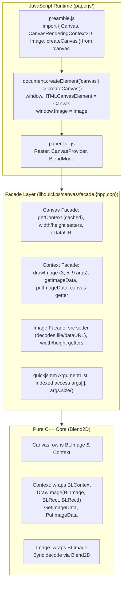

# Re-Architecting `libquickps/canvas` as a Native ES Module & Paper.js `Raster` Support

## 1. Motivation & Current Limitations

Currently, `paper.js` and `libquickps/canvas` are wired together imperatively after `paper.bc` has already been evaluated:

1. **Module Load Order Problem ([`libquickps/quickps.cpp`](file:///home/ksh/quickps/libquickps/quickps.cpp#L11-L17))**:
   - `QuickPs::Init()` evaluates `paper.bc` (`LoadPaper()`) *before* registering `Canvas` and `CanvasRenderingContext2D`.
   - When `paper-full.js` initializes at [`paper-full.js:39`](file:///home/ksh/quickps/build/paper-full.js#L39), it immediately probes:
     ```js
     if (window && !document.createElement('canvas').getContext('2d'))
         window = null;
     ```
   - To prevent `window` from becoming `null` before C++ classes are registered, [`paperjs/preamble.js`](file:///home/ksh/quickps/paperjs/preamble.js#L4-L9) patches `HTMLElement.prototype.getContext` with a dummy stub (`{ save() {}, restore() {} }`).
2. **Post-Hoc Global Mutation**:
   - [`PaperScope::PaperScope`](file:///home/ksh/quickps/libquickps/quickps.cpp#L92-L95) manually sets `self.window.HTMLCanvasElement = qps.canvas()`.
   - [`PaperScope::Inject()`](file:///home/ksh/quickps/libquickps/quickps.cpp#L97-L105) calls `PaperScope.inject({ createCanvas })` to override `PaperScope.prototype.createCanvas`.
3. **Broken Internal `CanvasProvider` in Paper.js**:
   - Whenever Paper.js internally allocates an offscreen canvas (for `Raster`, `getAverageColor()`, `BlendMode`, or CSS named-color probing) via [`CanvasProvider.getCanvas`](file:///home/ksh/quickps/build/paper-full.js#L20167-L20194), it calls `document.createElement('canvas')`.
   - Because `document.createElement('canvas')` returns a `nodom.js` `HTMLElement` with the dummy `getContext` stub instead of a Blend2D-backed `quickps::canvas::Canvas`, internal offscreen canvases in Paper.js do not work.
4. **Current Canvas Implementation & Facade Limitations**:
   - `canvas.getContext('2d')` creates a new `Context` every call instead of caching it, violating `canvas.getContext('2d') === canvas.getContext('2d')`.
   - `ctx.canvas` back-reference is missing.
   - `canvas.width` and `canvas.height` setters are no-ops, breaking `CanvasProvider.release(canvas)` (`canvas.width = canvas.height = 0`) and dynamic resizing.
   - `Context` has dummy signatures for raster (`void DrawImage(double, ...)` and `void CreateImageData(double, ...)`).
   - In `quickjsmm`, forward-iterator `ValueIter` argument extraction lacks random access and count checks, making variable-arity overloads (`drawImage` with 3, 5, or 9 args) fragile and incurring function call and iterator copy overhead.

---

## 2. Target Architecture: Native `'canvas'` ES Module & Refactored Facade



The architecture preserves the **Facade Pattern**:
- **Core C++ Layer (`libquickps/canvas/context.{hpp,cpp}`)**: Pure C++ graphics logic wrapping Blend2D. Knows nothing about QuickJS or JS garbage collection.
- **Facade Layer (`libquickps/canvas/facade.{hpp,cpp}`)**: Boundary between QuickJS and C++. Unpacks JS arguments, handles JS polymorphism (`Canvas` vs `Image`), converts pixel buffers (`PRGB32` <-> straight `RGBA8`), and translates C++ exceptions.

---

## 3. Step-by-Step Implementation Plan

### Phase 1: Native ES Module Support & ArgumentList Modernization in `quickjsmm`

#### 1.1 `ArgumentList` Random Access (Zero Overhead)
Update [`libquickps/quickjsmm/value.hpp`](file:///home/ksh/quickps/libquickps/quickjsmm/value.hpp) and [`libquickps/quickjsmm/value.cpp`](file:///home/ksh/quickps/libquickps/quickjsmm/value.cpp):
- Add `size_t size() const noexcept { return argc_; }`
- Add `bool empty() const noexcept { return argc_ == 0; }`
- Add `Value operator[](size_t i) const noexcept { return Value(js_values_[i]); }`
- Add `template <typename T> T Get(size_t i, Context &ctx) const { return (*this)[i].Get<T>(ctx); }`
- Eliminates iterator copies and out-of-line iterator method calls, enabling clean `switch (args.size())` for overloads.

#### 1.2 Module Registration API
Extend [`libquickps/quickjsmm/esm.hpp`](file:///home/ksh/quickps/libquickps/quickjsmm/esm.hpp) and [`libquickps/quickjsmm/context.hpp`](file:///home/ksh/quickps/libquickps/quickjsmm/context.hpp):
- `Context::RegisterModule(const char *name, std::initializer_list<...>)` wrapping `JS_NewCModule`, `JS_AddModuleExport`, and `JS_SetModuleExport`.
- Support exporting class constructors (`Canvas`, `CanvasRenderingContext2D`, `Image`) and functions (`createCanvas`).

#### 1.3 Bytecode Module Resolution & Build-Time Loader
- In [`Context::LoadModule`](file:///home/ksh/quickps/libquickps/quickjsmm/context.hpp#L120): call `JS_ResolveModule` to link `import ... from 'canvas'` against registered C modules.
- In [`subprojects/packagefiles/quickjs/compile_bc.c`](file:///home/ksh/quickps/subprojects/packagefiles/quickjs/compile_bc.c): add `compile_bc_module_loader` returning a dummy `JS_NewCModule` so `compile_bc` successfully compiles ES modules with external imports.

---

### Phase 2: Canvas & Context Lifecycle Refactoring in Facade & Core

#### 2.1 Caching `Context` on `Canvas` & `ctx.canvas` Back-Reference
- In [`libquickps/canvas/context.hpp`](file:///home/ksh/quickps/libquickps/canvas/context.hpp):
  - `Canvas` holds a cached `std::unique_ptr<Context>` (or initializes it on first `getContext('2d')`).
  - `Context` holds a pointer back to its owning `Canvas*`.
- In [`libquickps/canvas/facade.cpp`](file:///home/ksh/quickps/libquickps/canvas/facade.cpp):
  - `facade::GetContext`: returns the cached JS `Context` object for this `Canvas` (ensuring `canvas.getContext('2d') === canvas.getContext('2d')`).
  - `facade::GetCanvas`: returns the owning `Canvas` JS object for `ctx.canvas`.

#### 2.2 Dynamic Resizing (`width`, `height`)
- Implement `Canvas::SetWidth(int w)` and `Canvas::SetHeight(int h)`:
  - If `w == 0` or `h == 0`, reset `surface_` to empty `BLImage`.
  - Otherwise, create `surface_.create(w, h, BL_FORMAT_PRGB32)`.
  - Rebind `context_.Impl().begin(surface_)` and reset context 2D state (identity matrix, default styles).
- In `facade.cpp`: connect `set_width` and `set_height` to `Canvas::SetWidth` / `Canvas::SetHeight`.

---

### Phase 3: Pure C++ Graphics Primitives in `Context` & `Image`

#### 3.1 Pure C++ Method Signatures on `Context`
In [`libquickps/canvas/context.hpp`](file:///home/ksh/quickps/libquickps/canvas/context.hpp):
```cpp
struct ImageDataBuffer {
  int width = 0;
  int height = 0;
  std::vector<uint8_t> data; // straight RGBA8
};

// Replace dummy double stubs with:
void DrawImage(const BLImage &image, double dx, double dy);
void DrawImage(const BLImage &image, const BLRect &dst);
void DrawImage(const BLImage &image, const BLRect &dst, const BLRectI &src);

ImageDataBuffer GetImageData(int sx, int sy, int sw, int sh);
void PutImageData(const ImageDataBuffer &buffer, int dx, int dy,
                  const BLRectI &dirty_rect);
```

#### 3.2 Native `Image` Class
Implement `class Image` in `libquickps/canvas/image.{hpp,cpp}`:
- Backed by `BLImage surface_`.
- Synchronously decodes files using `surface_.read_from_file(path.c_str())`.
- Synchronously decodes base64 data URLs (`data:image/...;base64,...`) via base64 decoder and `surface_.read_from_data(...)`.
- Exposes `width`, `height`, `naturalWidth`, `naturalHeight`, `complete`, `src`, `crossOrigin`.

---

### Phase 4: Facade Dispatch for Raster APIs

#### 4.1 `facade::DrawImage`
- Inspects `args[0]`: extracts `const BLImage&` from either `Canvas*` or `Image*`.
- Dispatches by `args.size()`:
  - 3 args: `(img, dx, dy)`
  - 5 args: `(img, dx, dy, dw, dh)`
  - 9 args: `(img, sx, sy, sw, sh, dx, dy, dw, dh)`
- Calls `c2d->DrawImage(...)`.

#### 4.2 `facade::GetImageData`, `CreateImageData`, `PutImageData`
- `CreateImageData`: creates `{ width, height, data: new Uint8ClampedArray(w * h * 4) }`.
- `GetImageData`: calls `c2d->GetImageData(...)`, allocates a QuickJS `Uint8ClampedArray`, copies straight `RGBA` bytes into it, and returns the ImageData object.
- `PutImageData`: reads `Uint8ClampedArray` from `imageData.data`, converts straight `RGBA` to premultiplied `PRGB32`, and calls `c2d->PutImageData(...)`.

#### 4.3 `facade::ToDataURL`
- Implements `canvas.toDataURL(type = "image/png")`:
  - Encodes `surface_` using `BLImageCodec::find_by_mime("image/png")` and `BLImage::write_to_data`.
  - Base64-encodes the buffer and returns `"data:image/png;base64,..."`.

---

### Phase 5: Bundling, `preamble.js`, and Integration

#### 5.1 `paperjs/bundle.sh` & `paperjs/preamble.js`
- In `bundle.sh`: add `--external:canvas`.
- In `preamble.js`:
  ```js
  import { Canvas, CanvasRenderingContext2D, Image, createCanvas } from 'canvas';

  // Override document.createElement('canvas')
  Document.prototype.createElement = function (tagName) {
    if (tagName === 'canvas') {
      return createCanvas(300, 150, 'image');
    }
    return new HTMLElement(tagName);
  };

  globalThis.self.HTMLCanvasElement = Canvas;
  globalThis.self.CanvasRenderingContext2D = CanvasRenderingContext2D;
  globalThis.self.Image = Image;
  globalThis.self.window.HTMLCanvasElement = Canvas;
  globalThis.self.window.CanvasRenderingContext2D = CanvasRenderingContext2D;
  globalThis.self.window.Image = Image;
  ```

#### 5.2 Clean up `libquickps/quickps.cpp`
- In `QuickPs::Init()`: register `'canvas'` module before calling `LoadPaper()`.
- Eliminate manual post-hoc injection in `PaperScope`.

---

## 6. Verification & Testing

1. **Unit Tests**:
   - `ArgumentList` indexed access and `.size()`.
   - `Canvas` resizing and context caching identity (`canvas.getContext('2d') === canvas.getContext('2d')`).
   - `Image` loading from file path and base64 data URL.
   - `DrawImage` (3, 5, 9 args) with `Canvas` and `Image` sources.
   - `getImageData` and `putImageData` round-trip color conversion.
   - `toDataURL()` output validity.
2. **End-to-End Tests**:
   - Create `new Raster('test.png')` and verify dimensions and pixel sampling.
   - `raster.getPixel(x, y)` and `raster.setPixel(x, y, color)`.
   - `CanvasProvider` pooling and offscreen canvas reuse in Paper.js.
   - Rendering PaperScript with Rasters to PNG output.

---

## 7. Implementation & Verification Status

- [x] **Phase 1: `quickjsmm` Native ES Module & `ArgumentList` Modernization**:
  - `ArgumentList::size()`, `empty()`, `operator[]`, and `Get<T>(i, ctx)` implemented with zero-overhead indexing.
  - Native ES module registration in `Runtime` / `Context`.
  - QuickJS bytecode compiler (`compile_bc.c`) updated with module dummy loader for native imports (`canvas`).
- [x] **Phase 2: Canvas & Context Lifecycle**:
  - Context caching identity (`canvas.getContext('2d') === canvas.getContext('2d')`) and `ctx.canvas` back-reference.
  - Dynamic resizing via `canvas.width` and `canvas.height` setters.
- [x] **Phase 3: Blend2D Raster Support**:
  - `Image` class supporting file paths and `data:` base64 URLs.
  - `drawImage` with 3, 5, and 9 arguments supporting `Canvas` and `Image` sources.
  - `getImageData` and `putImageData` with straight-alpha / premultiplied RGBA conversions.
  - `toDataURL` for PNG export.
- [x] **Phase 4: Paper.js Preamble & Integration**:
  - `paperjs/preamble.js` imports `{ Canvas, CanvasRenderingContext2D, Image, createCanvas } from 'canvas'`.
  - `Document.prototype.createElement('canvas')` uses `createCanvas(300, 150, 'image')`.
  - `QuickPs::Init()` registers `canvas` before loading `paper.bc`.
- [x] **Phase 5: Example Showcase**:
  - Added Wikipedia Smiley PNG asset in [`examples/smiley.png`](file:///home/ksh/quickps/examples/smiley.png).
  - Added PaperScript example in [`examples/src/smiley.js`](file:///home/ksh/quickps/examples/src/smiley.js) demonstrating original and negative-positive inverted Paper.js `Raster` items.
  - Verified `ninja -C build test` (both `quickps:unit test` and `quickps:integration test` passing 100%).
  - Verified `qpsc` renders `examples/smiley.js` cleanly to both PNG and SVG.
- [x] **Phase 6: CLI Pre-loaded Images & DOM Resolution (`--image`, `--img:`)**:
  - Added `-I, --image <id>=<path>` and `--img:<id>=<path>` CLI flags to `qpsc`.
  - Added `Document.prototype.registerImage(id, image)` and hooked `Document.prototype.getElementById(id)`.
  - Exposed `globalThis.document`, `globalThis.Image`, and `window.document` to PaperScript.
  - Extended pytest fixture with `--image` option and updated integration tests.
- [x] **Phase 7: Security Boundary (Disallow Direct Filesystem Reads from JS)**:
  - Disallowed implicit file reading via `image.src = path` or `new Raster(path)` from JavaScript runtime; only inline `data:` URLs are accepted from JS.
  - Restricted filesystem reads to host C++ API (`Image::LoadFromFile`, invoked solely via `QuickPs::RegisterImage` from CLI/host).
  - Verified with unit tests that direct filesystem paths from JS do not load (`naturalWidth == 0`, `complete == false`).
