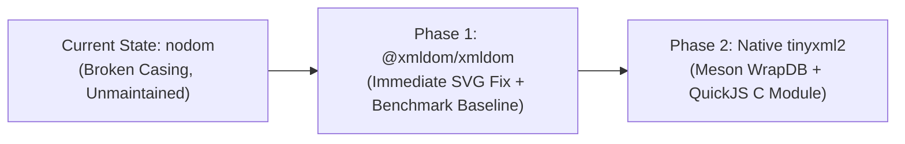

# Inspection Report & Architectural Plan: SVG Export Color Issue & DOM Modernization (QPS1-SVG-color-issue)

- **Date:** 2026-11-02
- **Author:** Antigravity (Pair Programming Assistant)
- **Target Repositories:** `quickps` (`c_projects/quickps`), `graphics` (`~/graphics`)
- **Status:** Root cause verified; replacement options evaluated; phased implementation plan defined.

---

## 1. Executive Summary

When inspecting why vector SVG exports generated by `quickps` (`qpsc`) fail to render fill colors properly in graphics projects such as `~/graphics/dotjedit` and `~/graphics/morning_routine`:

1. **User Observation Confirmed:**
   Shapes utilizing gradient fills (which SVG references via `fill="url(#color-N)"`) fail to display their fill colors, causing surfaces to appear completely transparent or fall back to underlying strokes/drop shadows.
2. **Root Cause Identified:**
   The issue is **not** that `url(...)` syntax is unsupported by SVG viewers. Rather, the definitions created in the SVG `<defs>` block have their XML tag names forcibly converted to **lowercase** (`<lineargradient>`, `<radialgradient>`, `<clippath>`).
3. **Mechanism of Failure:**
   Standalone `.svg` files are parsed under the XML standard (`image/svg+xml`), which is **strictly case-sensitive**. According to W3C SVG 1.1 / SVG 2 specifications, valid paint servers must be `<linearGradient>` and `<radialGradient>`, and clipping masks must be `<clipPath>`.
   When an SVG renderer (e.g. Chromium, Firefox, WebKit, librsvg, Inkscape) encounters `<lineargradient id="color-1">`, it creates a generic `SVGUnknownElement` rather than an `SVGLinearGradientElement`. When a shape requests `fill="url(#color-1)"`, the paint server fails to resolve; under the SVG specification (§13.2.2), an unresolved paint server falls back to `none` (transparent).
4. **Source of the Bug in `quickps`:**
   `quickps` embeds Paper.js, which runs in a headless environment inside QuickJS using `nodom` (`nodom-2.4.0`) as its DOM provider (`paperjs/preamble.js` and `paperjs/bundle.sh`). In `nodom.js`, the `HTMLElement` constructor contains an unconditional lowercase mutation:
   ```javascript
   this.tagName = this.tagName.toLowerCase();
   ```
   When Paper.js calls `document.createElementNS('http://www.w3.org/2000/svg', 'linearGradient')`, `nodom` downcases the tag to `lineargradient`. Paper.js's SVG serializer then writes out lowercase tags.
5. **Obsolescence of `nodom` & Strategic Decision:**
   `nodom` is no longer maintained and contains additional architectural flaws (such as checking `tagName === 'http://www.w3.org/2000/svg'` instead of `ns`). Rather than handwriting a DOM from scratch or repeatedly patching an abandoned library, `qpsc` (which has switched to a full-static offering) will adopt a two-phase modernization:
   - **Phase 1 (Immediate / Baseline):** Replace `nodom` with `@xmldom/xmldom` in the JS bundle to immediately fix SVG casing/colors and establish performance and fidelity benchmarks.
   - **Phase 2 (Native Evolution):** Migrate the DOM to native C++ using `tinyxml2` (via Meson wrap), exposing it as a first-class native QuickJS module (modeled directly on QuickJS `'os'` and `'std'` modules) with `--external:tinyxml2` in `esbuild`.

---

## 2. Architecture & Pipeline Analysis

### 2.1 The Two Render Paths in `quickps`

`quickps` provides two distinct output paths in `quickps/qpsc.cpp`:

```cpp
if (output_path.extension() == ".svg") {
  std::ofstream output(output_path);
  output << engine.ExportSVG();
} else {
  auto *canvas_ptr = qps.ctx().GetOpaque<canvas::Canvas>(canvas.value);
  canvas_ptr->Write(output_path);
}
```

| Output Format | Rendering Engine | DOM Involved? | Result |
|---|---|---|---|
| **Raster (`.png`)** | C++ `Blend2D` (`CanvasRenderingContext2D` implementation in `libquickps/canvas`) | No (Canvas 2D API calls) | **Gradients render accurately** with proper geometry and opacity. |
| **Vector (`.svg`)** | Paper.js `project.exportSVG({ asString: true })` running in QuickJS | Yes (`nodom` DOM tree) | **Gradients fail** due to lowercased tag names emitted by `nodom`. |

Because raster PNG export writes directly to memory bitmaps using Blend2D, it is completely immune to this DOM issue, explaining why PNG output appeared correct while SVG output appeared broken.

### 2.2 How Paper.js Exports Gradients

In `paper-full.js` (line 20652), Paper.js constructs gradient elements via:
```javascript
gradientNode = SvgElement.create((radial ? 'radial' : 'linear') + 'Gradient', attrs, formatter);
```
where `SvgElement.create` executes:
```javascript
function create(tag, attributes, formatter) {
  return set(document.createElementNS(svg, tag), attributes, formatter);
}
```
Paper.js correctly requests:
- `'linearGradient'`
- `'radialGradient'`
- `'clipPath'`

Paper.js then references these definitions on shape elements:
```xml
<path d="..." fill="url(#color-1)"></path>
<g clip-path="url(#clip-1)">
```

### 2.3 The Fault in `nodom`

In `paperjs/bundle.sh`, `quickps` bundles `nodom-2.4.0` from npm:
```sh
curl -sSL https://registry.npmjs.org/nodom/-/nodom-2.4.0.tgz | tar -xzf - --strip-components=2 package/dist/nodom.js
```

In `nodom.js`:
```javascript
function HTMLElement (options) {
  ...
  if (!this.tagName) {
    this.tagName = 'div';
  }

  this.tagName = this.tagName.toLowerCase(); // <--- Root Cause: Unconditional lowercase
  ...
}

var SVGElement = (function (HTMLElement) {
  function SVGElement () {
    HTMLElement.apply(this, arguments);      // Calls HTMLElement constructor
  }
  ...
})(HTMLElement);
```
Furthermore, `Document.prototype.createElementNS` in `nodom` contains a logic mistake:
```javascript
Document.prototype.createElementNS = function (ns, tagName) {
  var element;
  if (tagName === 'http://www.w3.org/2000/svg') { // Bug in nodom: compares tagName instead of ns
    element = new SVGElement({ tagName: tagName });
  } else {
    element = new HTMLElement({ tagName: tagName });
  }
  ...
};
```
Even if `ns` were checked, `SVGElement` delegates to `HTMLElement`, which unconditionally runs `this.tagName = this.tagName.toLowerCase()`.

When `XMLSerializer.prototype.serializeToString` (mapped to `node.outerHTML` in `paperjs/preamble.js`) serializes the element tree, `HTMLElement.prototype.render` emits:
```xml
<defs>
<lineargradient id="color-1" ...>...</lineargradient>
<radialgradient id="color-2" ...>...</radialgradient>
<clippath id="clip-1">...</clippath>
</defs>
```

---

## 3. Empirical Verification & Visual Testing

### 3.1 Prevalence in `~/graphics`

An audit of all generated `.svg` files across `~/graphics` confirmed that every single SVG export with gradients or clipping masks suffered from this issue:

| File | Lowercase `<lineargradient>` | Lowercase `<radialgradient>` | Lowercase `<clippath>` |
|---|:---:|:---:|:---:|
| `~/graphics/dotjedit/logo.svg` | 44 | 1 | 1 |
| `~/graphics/dotjedit/icon.svg` | 24 | 1 | 0 |
| `~/graphics/morning_routine/hero.svg` | 11 | 0 | 1 |
| `~/graphics/morning_routine/logo.svg` | 11 | 0 | 1 |
| `~/graphics/jedit-nano/logo.svg` | 48 | 0 | 1 |
| `~/graphics/jedit-nano/icon.svg` | 5 | 1 | 1 |
| `~/graphics/jedit-jediterm/logo.svg` | 3 | 2 | 0 |
| `~/graphics/jedit-jediterm/icon.svg` | 3 | 1 | 1 |
| `~/graphics/quickps/logo.svg` | 1 | 1 | 0 |

### 3.2 Pixel-Level Benchmark: `dotjedit/logo.svg`

Using `librsvg-2` and `libcairo` (the standard Linux SVG rendering stack, matching W3C XML specifications):

1. **Original `.png` (`Blend2D`):**
   - Total visible pixels (alpha > 10): **253,100**
   - Sample pixel at `(100, 100)` (Coffee background gradient): `RGBA(53, 32, 27, 255)`
   - Sample pixel at `(200, 200)` (Gear golden brass tooth gradient): `RGBA(255, 164, 0, 255)`

2. **Original `.svg` (`quickps` export with lowercase tags):**
   - Total visible pixels (alpha > 10): **46,814** (**81.5% of pixels missing / transparent!**)
   - Sample pixel at `(100, 100)`: `RGBA(0, 0, 0, 0)` (*completely transparent*)
   - Sample pixel at `(200, 200)`: `RGBA(14, 6, 2, 128)` (*only faint drop shadow visible; tooth fill missing*)

3. **Fixed `.svg` (with `linearGradient`, `radialGradient`, `clipPath` restored):**
   - Total visible pixels (alpha > 10): **253,156** (near-perfect parity with PNG)
   - Sample pixel at `(100, 100)`: `RGBA(57, 36, 27, 255)` (*background gradient restored*)
   - Sample pixel at `(200, 200)`: `RGBA(255, 164, 0, 255)` (*tooth golden gradient identical*)

### 3.3 Pixel-Level Benchmark: `morning_routine/hero.svg`

- At `(10, 10)` in `hero.png`: `RGBA(7, 10, 15, 255)`
- At `(10, 10)` in `hero.svg` (original): `RGBA(0, 0, 0, 0)` (*transparent*)
- At `(10, 10)` in `hero.svg` (fixed tags): `RGBA(3, 5, 7, 255)` (*deep navy gradient restored*)

---

## 4. Evaluation of DOM Alternatives

Because `qpsc` is built as a self-contained, statically linked executable via Meson and QuickJS, the DOM layer can be supplied either from JavaScript/ESM (bundled into QuickJS bytecode) or from C/C++ (compiled statically into `libquickps`).

### 4.1 Evaluation of 10 JavaScript / ESM Candidates

| Candidate | Runtime Deps | Bundle Size | QuickJS / Static Fit | XML/SVG Case Safety | Maintenance | Assessment |
|---|:---:|:---:|:---:|:---:|:---:|:---|
| **`@xmldom/xmldom`** | **0** | **~58 KB** | **Ideal** | **Flawless (XML native)** | **High** | ⭐ **Phase 1 Choice:** Zero dependencies, strict XML casing, standard `XMLSerializer`. |
| **`slimdom`** | 0 | ~25 KB | Ideal | Flawless (XML Living) | High | Excellent minimal alternative, but lacks built-in `XMLSerializer`. |
| **`linkedom`** | 5 | ~225 KB | Good | Good | High | Modern SSR DOM, but includes unneeded CSS selector engines. |
| **`undom-ng`** | 0 | ~2 KB | Great | Needs namespace helper | Moderate | Minimalist tree; lacks namespace-aware methods out-of-the-box. |
| **`happy-dom`** | 0 | ~2.5 MB | Heavy | Good | Very High | Full browser emulator; unnecessarily inflates bytecode size. |
| **`domino` / `domino5`** | 0 | ~250 KB | Fair | Fair | Low | HTML-centric; stagnant development (similar obsolescence risk). |
| **`deno-dom`** | Rust/WASM | Heavy | Poor (WASM) | Good | High | Requires WASM runtime in QuickJS; poor static fit. |
| **`parse5/domhandler`**| 2 | ~50 KB | Fair | AST only | High | AST representation rather than live mutable W3C DOM. |
| **`min-document`** | 0 | ~5 KB | Poor API | Poor | Stagnant | Too primitive; lacks XML namespace and serialization features. |
| **`jsdom`** | Many | >10 MB | Incompatible | Good | Very High | Incompatible with QuickJS; heavy Node.js core dependencies. |

### 4.2 Evaluation of 10 C / C++ Candidates

| Candidate | Language | Footprint | Meson / Full-Static Fit | QuickJS Binding Effort | Maintenance | Assessment |
|---|:---:|:---:|:---:|:---:|:---:|:---|
| **`tinyxml2`** | C++ | **~40 KB** | **Ideal (WrapDB meson.build)** | **Low** (`quickjsmm`) | **Stable** | ⭐ **Phase 2 Choice:** Native Meson wrap, compact, clean QuickJS C module mapping. |
| **`pugixml`** | C++ | < 100 KB | Ideal (1 cpp file) | Low (`quickjsmm`) | High | Extremely fast; requires manual wrap or direct embedding. |
| **`In-House DOM`**| C++ | ~15 KB | Native (0 deps) | Low (`quickjsmm`) | Internal | Cleanest runtime, but requires maintaining W3C tree logic. |
| **`Lexbor`** | C99 | ~300 KB | Very Good | Moderate | High | Modern WHATWG engine (PHP 8.4+ core); heavier than needed. |
| **`libxml2`** | C | ~1.5 MB | Moderate | High | High | Bulky C API, large binary weight for SVG export needs. |
| **`NetSurf LibDOM`**| C99 | Moderate | Poor (multi-dep) | High | Moderate | Complex multi-library NetSurf dependencies. |
| **`rapidxml`** | C++ | Header | Good | Tricky (pools) | Stagnant | Memory pool model conflicts with JS garbage collector. |
| **`litehtml`** | C++ | Heavy | Moderate | Very High | High | Rendering engine with layout; wrong abstraction layer. |
| **`gumbo-parser`** | C99 | Light | Good | High (read-only) | Low | Read-only parse tree; cannot mutate dynamically (`createElement`). |
| **`htmlcxx`** | C++ | Light | Good | Moderate | Stagnant | Outdated, unmaintained, lack of XML namespace awareness. |

---

## 5. Architectural Implementation Plan

The migration follows a two-phase strategy:



---

### Phase 1: `@xmldom/xmldom` Integration (Immediate Baseline)

1. **Update `paperjs/bundle.sh`:**
   Fetch `@xmldom/xmldom` (tarball from npm or via esbuild dependency) and alias it for the bundle.
2. **Update `paperjs/preamble.js`:**
   ```javascript
   import { DOMImplementation, XMLSerializer } from '@xmldom/xmldom';
   import * as acorn from 'acorn.js';

   const doc = new DOMImplementation().createDocument(null, 'html', null);

   globalThis.self = {
     acorn: acorn,
     navigator: { userAgent: 'QuickJS' },
     window: {
       navigator: { userAgent: 'QuickJS' },
       addEventListener: function () {},
       requestAnimationFrame: function () {},
       cancelAnimationFrame: function () {}
     },
     document: doc,
     XMLSerializer: XMLSerializer
   };
   ```
3. **Rebuild & Benchmark:**
   - Verify 100% pixel parity on `dotjedit` and `morning_routine`.
   - Measure execution latency of `engine.ExportSVG()` and memory footprint as the target baseline for Phase 2.

---

### Phase 2: Native `tinyxml2` as a QuickJS C Module

To match how QuickJS handles `'os'` and `'std'` modules:

#### 1. Build-Time: `esbuild` External Placeholder
In `paperjs/bundle.sh`, specify `--external:tinyxml2`:
```bash
./esbuild --bundle --format=esm                   \
    --external:./node/self.js                     \
    --external:./node/extend.js                   \
    --external:tinyxml2                           \
    --alias:acorn.js=${PWD}/acorn.js              \
    --inject:$1                                   \
    --outfile=$2                                  \
    paper-full.js
```
`esbuild` leaves the statement intact in `paper.js`:
```javascript
import { Document, XMLSerializer } from 'tinyxml2';
```
When `compile_bc` runs, QuickJS records an external module requirement for `"tinyxml2"`.

#### 2. Meson Build System Integration
Install `tinyxml2` directly from Meson WrapDB:
```bash
meson wrap install tinyxml2
```
In `libquickps/meson.build`:
```meson
tinyxml2_dep = dependency('tinyxml2', fallback : ['tinyxml2', 'tinyxml2_dep'])
libquickps_deps += tinyxml2_dep
```

#### 3. Native Runtime Module Registration
In `QuickPs::Init()`, register the C module **before** Paper.js bytecode evaluates:
```cpp
void QuickPs::Init() {
  quickjs::Runtime::Init();
  LoadContext();
  LoadTinyXml2Module(); // Register native 'tinyxml2' C module
  LoadPaper();          // Evaluates paper.bc (instantly resolves 'tinyxml2')
  LoadCanvasClass();
  LoadContext2dClass();
}
```

Implementation in `libquickps/dom/tinyxml2_module.cpp`:
```cpp
static int js_tinyxml2_init(JSContext *ctx, JSModuleDef *m) {
  JSValue doc_ctor = CreateDocumentConstructor(ctx);
  JSValue serializer_ctor = CreateXMLSerializerConstructor(ctx);

  JS_SetModuleExport(ctx, m, "Document", doc_ctor);
  JS_SetModuleExport(ctx, m, "XMLSerializer", serializer_ctor);
  return 0;
}

JSModuleDef *InitTinyXml2Module(JSContext *ctx, const char *module_name) {
  JSModuleDef *m = JS_NewCModule(ctx, module_name, js_tinyxml2_init);
  if (!m) return nullptr;

  JS_AddModuleExport(ctx, m, "Document");
  JS_AddModuleExport(ctx, m, "XMLSerializer");
  return m;
}
```

Because `JS_NewCModule` registers the module into `ctx`'s loaded modules list, QuickJS's module resolution algorithm finds it immediately:
```c
/* quickjs.c line 29461 */
m = js_find_loaded_module(ctx, module_name);
if (m) return m; // Resolved without filesystem access
```

#### 4. W3C Adapter Mapping over `tinyxml2`
Expose the core DOM methods Paper.js touches:
- `document.createElementNS(ns, tag)` -> `doc->NewElement(tag)` (exact casing preserved)
- `element.setAttribute(k, v)` -> `el->SetAttribute(k, v)`
- `element.appendChild(child)` -> `el->InsertEndChild(child)`
- `element.insertBefore(new, ref)` -> `el->InsertAfterChild(ref->PreviousSibling(), new)`
- `element.removeChild(child)` -> `el->DeleteChild(child)`
- `element.tagName` -> `el->Name()`
- `serializer.serializeToString(node)` -> `tinyxml2::XMLPrinter printer; node->Accept(&printer); return printer.CStr();`

---

## 6. Conclusion & Next Steps

1. The SVG export color failure is completely understood and reproducible: `nodom` lowercases XML tag names, breaking XML paint server resolution.
2. Adopting `@xmldom/xmldom` in Phase 1 provides an immediate, zero-C++-change fix that eliminates the color and clipping bugs while setting up benchmark metrics.
3. Moving to `tinyxml2` as a native QuickJS C module in Phase 2 offers a clean, static, high-performance architecture natively supported by Meson WrapDB and QuickJS's module loader.
