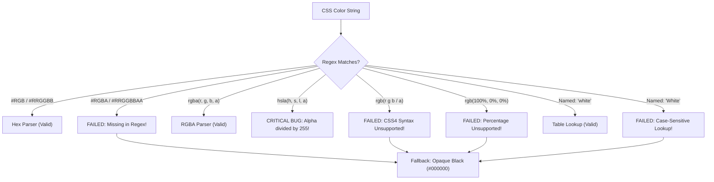

# Comprehensive Audit: HTML Canvas Context 2D to Blend2D Completeness & CSS Color Edge Cases (QPS2-Context2D-completeness)

- **Date:** 2026-11-02
- **Author:** Antigravity (Pair Programming Assistant)
- **Target Subsystem:** `libquickps/canvas` (`Context`, `Canvas`, `Style`, `Color`, `Facade`)
- **Status:** Complete code audit & spec-gap analysis.

---

## 1. Executive Summary

`quickps` embeds QuickJS and translates HTML5 Canvas 2D Context API calls into native C++ 2D rendering commands via [Blend2D](https://blend2d.com/). While basic path construction (`moveTo`, `lineTo`, `bezierCurveTo`), solid fills, stroke styling, and linear/radial gradients are operational for core geometric compositions, **substantial portions of the HTML Canvas 2D specification are either stubbed out, omitted from the QuickJS prototype, or afflicted by subtle behavioral bugs.**

### Key Findings at a Glance:
1. **Text Rendering is Completely Inoperative:**
   `fillText`, `strokeText`, `measureText`, and typography properties (`font`, `textAlign`, `textBaseline`) are either dummy stubs taking `double text` or not exposed to JavaScript at all. Paper.js `PointText` items will crash or fail silently.
2. **Drop Shadows Are Completely Ignored:**
   `shadowColor`, `shadowBlur`, `shadowOffsetX`, and `shadowOffsetY` exist as unused C++ fields in `Context`, but have **no getters or setters exposed to JavaScript**. In Blend2D, drop shadows require layer-based Gaussian blur emulation that is not yet implemented.
3. **Severe CSS Color Calculation Bug in `hsla()`:**
   In [libquickps/canvas/color.cpp](file:///home/ksh/c_projects/quickps/libquickps/canvas/color.cpp), the alpha channel of `hsla()` is divided by `255` (`alpha = stof(...) / 255`). Because CSS alpha is defined on `[0.0, 1.0]`, a standard value like `hsla(0, 100%, 50%, 1.0)` produces `alpha = 0.0039` (**99.6% transparent**).
4. **CSS Color Parsing Blind Spots:**
   Hex colors with alpha (`#RGBA`, `#RRGGBBAA`), modern CSS Color 4 space-separated syntax (`rgb(255 0 0 / 0.5)`), percentage RGB (`rgb(100%, 0%, 0%)`), and capitalized named colors (`"White"`) are rejected and silently fall back to opaque black.
5. **Image & Pixel Manipulation Is Missing:**
   `drawImage` (all 3 overloads), `createImageData`, `getImageData`, and `putImageData` are unexposed or throw `Unimplemented()`, preventing Paper.js `Raster` operations and pixel sampling.
6. **Canvas State & Lifecycle Violations:**
   - `canvas.getContext('2d')` allocates a **new C++ `Context` on every call** rather than returning a singleton instance.
   - `canvas.width` and `canvas.height` setters are silent no-ops, breaking dynamic resizing and clearing.
   - Reading `ctx.fillStyle` when holding a gradient returns a brand-new wrapper object, breaking object identity (`ctx.fillStyle === grad` evaluates to `false`).

---

## 2. Detailed Gap Analysis by Subsystem

### 2.1 Text & Typography (The Biggest Gap)

In [libquickps/canvas/context.hpp](file:///home/ksh/c_projects/quickps/libquickps/canvas/context.hpp) and [libquickps/canvas/context.cpp](file:///home/ksh/c_projects/quickps/libquickps/canvas/context.cpp):

```cpp
// In context.hpp:
void FillText(double text, double x, double y, double maxWidth);
void StrokeText(double text, double x, double y, double maxWidth);
void MeasureText(double text);
int font;
int textAlign;
int textBaseline;

// In context.cpp:
void Context::FillText([[maybe_unused]] double text, ...) {}
void Context::StrokeText([[maybe_unused]] double text, ...) {}
void Context::MeasureText([[maybe_unused]] double text) {}
```

#### Discovered Deficiencies:
1. **Wrong Parameter Types:** Text arguments are typed as `double text` instead of `const std::string &text`.
2. **Not Exposed to QuickJS:** In [libquickps/canvas/context.cpp](file:///home/ksh/c_projects/quickps/libquickps/canvas/context.cpp) (`GetClass<canvas::Context>()`), `fillText`, `strokeText`, `measureText`, `font`, `textAlign`, and `textBaseline` are **completely omitted from the prototype**.
3. **Paper.js Breakdown:**
   Paper.js `PointText` executes:
   ```javascript
   ctx.font = piece.font;
   ctx.measureText(lines[i]).width;
   ctx.fillText(piece.content, x, 0);
   ```
   In `quickps`, `ctx.measureText(...)` will throw `TypeError: ctx.measureText is not a function`.
4. **Underlying Blend2D Challenge:**
   HTML5 Canvas accepts high-level CSS font strings (e.g. `"bold 16px Inter, sans-serif"`). Blend2D does not have a CSS font cascade/resolver; it requires explicit `BLFontFace` and `BLFont` objects loaded from true font files (TTF/OTF) via `font_face.create_from_file(...)`, shaped through `BLGlyphBuffer`, and rendered with `ctx.fill_glyph_run(...)`. Implementing text requires integrating a font loader/fallback cache (or FreeType/Fontconfig).

---

### 2.2 Shadows & Filtering

HTML Canvas defines four properties for drop shadows:
- `ctx.shadowColor` (CSS color string, default: `rgba(0, 0, 0, 0)`)
- `ctx.shadowBlur` (non-negative float, default: `0`)
- `ctx.shadowOffsetX` (float, default: `0`)
- `ctx.shadowOffsetY` (float, default: `0`)

#### Discovered Deficiencies:
1. **Unwired C++ Fields:** In `context.hpp`, these exist as raw fields:
   ```cpp
   double shadowOffsetX = 0.0;
   double shadowOffsetY = 0.0;
   double shadowBlur = 0.0;
   std::array<int, 4> shadowColor = {0, 0, 0, 0};
   ```
   None of them have getters or setters in `GetClass<canvas::Context>()`. When Paper.js executes:
   ```javascript
   ctx.shadowColor = style.getShadowColor().toCanvasStyle(ctx);
   ctx.shadowBlur = blur.getLength();
   ```
   QuickJS simply sets expando properties on the JS wrapper; the C++ rendering engine never sees them.
2. **No Native Shadow API in Blend2D:**
   Blend2D's `BLContext` does not have an automatic drop-shadow mode. Supporting Canvas shadows requires:
   - Rendering the path to an offscreen alpha mask layer.
   - Running a Gaussian/box blur filter over the mask.
   - Drawing the blurred, colorized mask at `(x + shadowOffsetX, y + shadowOffsetY)`.
   - Drawing the actual fill/stroke on top.

---

### 2.3 CSS Color Calculation: Edge Cases & Bugs

`libquickps/canvas/color.cpp` implements manual CSS color parsing via regular expressions.



#### 1. The Critical `hsla()` Alpha Bug (High Severity)
In `libquickps/canvas/color.cpp` (lines 80–84):
```cpp
} else if (std::regex_match(str, match_result, kHsla)) {
  auto hue = std::stoi(match_result[1]);
  auto saturation = std::stoi(match_result[2]);
  auto lightness = std::stoi(match_result[3]);
  auto alpha = std::stof(match_result[4]) / 255; // <--- BUG!
  return Color::FromHsla(hue, saturation, lightness, alpha);
```
- In CSS, alpha in `hsla()` is defined in `[0.0, 1.0]` (e.g. `hsla(180, 50%, 50%, 0.5)`).
- Dividing by 255 turns `0.5` into `0.00196` and `1.0` into `0.00392`.
- **Result:** Any shape colored with `hsla()` renders completely invisible.

#### 2. Hex Colors with Alpha Omitted
The hex regex only matches 3-digit and 6-digit hex:
```cpp
static const std::regex kHex("^#([[:xdigit:]]{6}|[[:xdigit:]]{3})$");
```
CSS Color 4 allows `#RGBA` (4-digit) and `#RRGGBBAA` (8-digit). Formats like `#FF335880` or `#F008` fail the regex match, fall through to `FromName`, and default to solid `#000000FF` (opaque black).

#### 3. Modern CSS Color 4 Space-Separated Syntax
Modern web standards allow:
- `rgb(255 0 0 / 0.5)`
- `hsl(210deg 50% 40% / 80%)`
Currently, only comma-separated syntax is matched.

#### 4. Percentages in RGB
`rgb(100%, 0%, 0%)` is valid CSS Canvas fill. The regex `\d+` without `%` fails to match.

#### 5. Case-Sensitive Named Colors
`Color::FromName` uses a direct `std::unordered_map::find` without prior lowercase normalization:
```cpp
Color Color::FromName(const std::string &str) {
  // If str == "White" or "RED", find fails!
  if (auto it = kNamedColors.find(str); it != kNamedColors.end()) ...
```
Capitalized CSS color names silently fail and resolve to black.

#### 6. Missing Named Colors
The map has ~100 names, but the W3C Extended Color Palette defines 148 colors (e.g. `rebeccapurple`, `currentColor`).

---

### 2.4 Image & Pixel Manipulation (`Raster` Support)

In [libquickps/canvas/context.cpp](file:///home/ksh/c_projects/quickps/libquickps/canvas/context.cpp):
```cpp
void Context::DrawImage([[maybe_unused]] double image, ...) {}
void Context::CreateImageData([[maybe_unused]] double sw, ...) { throw Unimplemented(); }
void Context::GetImageData([[maybe_unused]] double sx, ...) {}
void Context::PutImageData([[maybe_unused]] double imagedata, ...) {}
```

#### Deficiencies:
1. `drawImage` is completely unimplemented and takes dummy `double` arguments.
2. In Paper.js, `Raster` items rely on `ctx.drawImage(canvas, dx, dy)` and `ctx.getImageData(...)` to extract and process pixels.
3. Neither `drawImage`, `getImageData`, nor `putImageData` are exported in the QuickJS Context prototype.
4. `ImageData` constructor is absent from the global scope.

---

### 2.5 State Management & `save()` / `restore()`

The HTML5 Canvas 2D specification requires that `save()` and `restore()` maintain a stack containing:
- Current transformation matrix (managed by Blend2D `BLContext::save()` / `restore()`).
- Current clip region (managed by `clip_stack_`).
- All stroke and fill styles, line attributes, global alpha, composite operation.
- **Shadow parameters** (`shadowOffsetX`, `shadowOffsetY`, `shadowBlur`, `shadowColor`).
- **Typography parameters** (`font`, `textAlign`, `textBaseline`, `direction`).
- **Image smoothing flags**.

In `quickps`:
- `libquickps/canvas/state.hpp` defines `struct State final { ... }` with fields for font, shadows, and dash lists, but **this struct is never used**.
- Any state not natively tracked inside Blend2D's internal state machine is lost across `save()` and `restore()`.

---

### 2.6 Canvas Lifecycle & Identity Inconsistencies

1. **`getContext('2d')` Instantiation:**
   In [libquickps/canvas/facade.cpp](file:///home/ksh/c_projects/quickps/libquickps/canvas/facade.cpp):
   ```cpp
   qjs::Value GetContext(qjs::Context &ctx, Canvas *canvas, ...) {
     auto ptr = qjs::Runtime::GetInstance().Ctor<Context>(canvas->CreateContext());
     return ctx.CreateOpaque<Context>(std::move(ptr), qjs::Value::GetNull()).cobj();
   }
   ```
   Every call creates a brand new C++ `Context` with a fresh `BLContext(surface_)`. In HTML5 Canvas, `canvas.getContext('2d')` must return the **same identical context object** for a given canvas.
2. **`canvas.width` and `canvas.height` Setters:**
   In `facade.cpp` (lines 711 & 717):
   ```cpp
   void set_width(qjs::Context &, Canvas *, qjs::Value) {}
   void set_height(qjs::Context &, Canvas *, qjs::Value) {}
   ```
   Both setters are empty no-ops. In HTML5, setting `canvas.width` or `canvas.height` clears the canvas to transparent black and resets all rendering state.
3. **`fillStyle` / `strokeStyle` Getter Identity Loss:**
   When reading `ctx.fillStyle` after assigning a gradient, `StyleToJSValue` constructs a brand-new `CanvasStyle` JS object wrapping the `BLGradient`. Identity checks like `ctx.fillStyle === myGradient` evaluate to `false`.

---

### 2.7 Paths & Path2D

1. **Missing `Path2D`:**
   Modern Canvas 2D allows constructing paths independently: `new Path2D()`, and calling `ctx.fill(path)`. Paper.js can target Path2D for performance caching.
2. **Missing Path Primitives:**
   - `ellipse(x, y, radiusX, radiusY, rotation, startAngle, endAngle [, anticlockwise])`
   - `roundRect(x, y, w, h, [radii])`
3. **Expensive Clip Masking Overhead:**
   Because Blend2D's native clipping historically focused on bounding boxes or specific clip modes, `quickps` implements arbitrary vector clipping via an offscreen mask buffer (`clip_mask_`). Under active clipping, every `fill_rect`, `stroke_path`, and `fill_path` allocates a full-screen `BLImage layer(w, h)`, renders into it, composites with `BL_COMP_OP_DST_IN`, and blits to the target surface. For complex paths, this incurs substantial memory and allocation overhead.

---

### 2.8 Gradients & Patterns

1. **`addColorStop` Parameter Validation:**
   In [libquickps/canvas/facade.cpp](file:///home/ksh/c_projects/quickps/libquickps/canvas/facade.cpp), `AddColorStop` accepts any offset without checking `0.0 <= offset <= 1.0` or `!isnan(offset)`. HTML Canvas specifies an `IndexSizeError` exception.
2. **Conic Gradients:**
   `createConicGradient(startAngle, cx, cy)` is part of Canvas 2D and is natively supported by Blend2D (`BL_GRADIENT_TYPE_CONICAL`), but is not yet exposed in `quickps`.
3. **`createPattern` Limitations:**
   Only accepts `Canvas &image`. In HTML Canvas, `createPattern` can accept Image, Video, or SVG.

---

## 3. Completeness Checklist Matrix

| Canvas 2D Feature Group | HTML5 Canvas 2D API | QuickJS Binding Status | Blend2D Impl Status | Notes / Priority |
|---|---|:---:|:---:|---|
| **Paths** | `beginPath`, `closePath`, `moveTo`, `lineTo`, `rect` | ✅ Exposed | ✅ Implemented | Working properly |
| | `quadraticCurveTo`, `bezierCurveTo` | ✅ Exposed | ✅ Implemented | Working properly |
| | `arcTo` | ✅ Exposed | ✅ Implemented | Custom math over `path_.arc_to` |
| | `arc` | ✅ Exposed | ✅ Implemented | Full sweep & direction logic |
| | `ellipse` | ❌ Missing | ⚠️ In BLPath | Needed for `Path.Ellipse` |
| | `roundRect` | ❌ Missing | ⚠️ In BLPath | Convenient for modern UI |
| | `Path2D` Constructor & Overloads | ❌ Missing | ⚠️ In BLPath | Path caching unavailable |
| **Styles & Colors** | `fillStyle`, `strokeStyle` (solid) | ✅ Exposed | ✅ Implemented | Working (subject to CSS parser) |
| | `fillStyle`, `strokeStyle` (gradient) | ✅ Exposed | ✅ Implemented | Linear & Radial functional |
| | `fillStyle`, `strokeStyle` (pattern) | ✅ Exposed | ⚠️ Partial | Only Canvas image supported |
| | `addColorStop` | ✅ Exposed | ⚠️ Unvalidated | Silently ignores invalid colors |
| | `createConicGradient` | ❌ Missing | ⚠️ In Blend2D | Supported by BL, not in Context |
| **CSS Color Parser** | Hex `#RGB`, `#RRGGBB` | ✅ Handled | ✅ Handled | Working |
| | Hex `#RGBA`, `#RRGGBBAA` | ❌ Missing | ❌ Missing | Falls back to opaque black |
| | `rgb()`, `rgba()` (commas) | ✅ Handled | ✅ Handled | Working |
| | `rgb()` (percentages) | ❌ Missing | ❌ Missing | Falls back to opaque black |
| | `rgb()` / `hsl()` (space + slash) | ❌ Missing | ❌ Missing | CSS Color 4 syntax fails |
| | `hsl()` | ✅ Handled | ✅ Handled | Working |
| | `hsla()` | ❌ **BROKEN** | ❌ **BROKEN** | **Alpha divided by 255 bug!** |
| | Named Colors | ⚠️ Partial | ⚠️ Partial | Case-sensitive; ~40 names missing |
| **Line Styles** | `lineWidth`, `lineCap`, `lineJoin` | ✅ Exposed | ✅ Implemented | Working properly |
| | `miterLimit` | ✅ Exposed | ✅ Implemented | Working properly |
| | `getLineDash`, `setLineDash`, `lineDashOffset` | ✅ Exposed | ✅ Implemented | Odd-length doubling handled |
| **Compositing** | `globalAlpha` | ✅ Exposed | ✅ Implemented | Working properly |
| | `globalCompositeOperation` | ✅ Exposed | ⚠️ Partial | 21 blend modes; clip-layer edge cases |
| **Shadows** | `shadowColor`, `shadowBlur` | ❌ Not in JS | ❌ No BL API | Exists as C++ fields only |
| | `shadowOffsetX`, `shadowOffsetY` | ❌ Not in JS | ❌ No BL API | Exists as C++ fields only |
| **Text** | `fillText`, `strokeText` | ❌ Not in JS | ❌ Dummy stub | **Parameter typed as `double`** |
| | `measureText` | ❌ Not in JS | ❌ Dummy stub | No `TextMetrics` returned |
| | `font`, `textAlign`, `textBaseline` | ❌ Not in JS | ❌ Raw C++ ints | No font loading/parsing |
| **Image & Pixels** | `drawImage` (3 overloads) | ❌ Not in JS | ❌ Dummy stub | Cannot draw images or subcanvases |
| | `createImageData` | ❌ Not in JS | ❌ Throws | Throws `Unimplemented()` |
| | `getImageData`, `putImageData` | ❌ Not in JS | ❌ Dummy stub | Cannot read/write raw pixels |
| **State & Lifecycle**| `save`, `restore` | ✅ Exposed | ⚠️ Incomplete | Unmanaged state (shadow/font) lost |
| | `getContext('2d')` | ✅ Exposed | ⚠️ Non-spec | Creates new instance every call |
| | `canvas.width`, `canvas.height` setters | ✅ Exposed | ❌ No-ops | Does not resize or clear buffer |
| | `resetTransform`, `getTransform` | ❌ Missing | ⚠️ In Blend2D | Easy to add from `BLMatrix2D` |

---

## 4. Prioritized Recommendations for `libquickps/canvas`

### Tier 1: Critical Bug Fixes (Immediate)
1. **Fix `hsla` Alpha Calculation:**
   In [libquickps/canvas/color.cpp](file:///home/ksh/c_projects/quickps/libquickps/canvas/color.cpp):
   ```cpp
   // Change line 83 from:
   auto alpha = std::stof(match_result[4]) / 255;
   // To:
   auto alpha = std::stof(match_result[4]);
   ```
2. **Support 4- and 8-digit Hex Colors:**
   Expand `kHex` in `color.cpp` to `^#([[:xdigit:]]{8}|[[:xdigit:]]{6}|[[:xdigit:]]{4}|[[:xdigit:]]{3})$` and parse alpha nibbles.
3. **Normalize Color Names to Lowercase:**
   In `Color::FromName`, convert input string to lowercase before hash table lookup.

### Tier 2: State & Lifecycle Parity
1. **Context Singleton per Canvas:**
   Store `std::unique_ptr<Context>` inside `Canvas` and have `GetContext` return the existing instance.
2. **Implement Canvas Resize (`set_width` / `set_height`):**
   Re-allocate `surface_.create(w, h, BL_FORMAT_PRGB32)` and reset the context state when `canvas.width` or `canvas.height` is modified.
3. **Expose `resetTransform()`:**
   Bind `resetTransform()` to call `Impl().reset_transform()`.

### Tier 3: Feature Expansion (Text, Shadows, Images)
1. **Typography Support:**
   - Define a minimal font loader using Blend2D's `BLFontFace` / `BLFont`.
   - Update `FillText` and `StrokeText` signatures to take `const std::string &`.
   - Expose `font` (string), `fillText`, `strokeText`, and `measureText` returning a `TextMetrics` object (`{ width: ... }`).
2. **Raster & `drawImage`:**
   - Support `drawImage(Canvas &source, double dx, double dy, ...)` by blitting `source.Impl()` via `BLContext::blit_image`.
3. **Drop Shadow Emulation:**
   - If `shadowColor.a > 0` and `shadowBlur > 0`, implement an offscreen blurred layer pass before rasterizing the primary shape.
