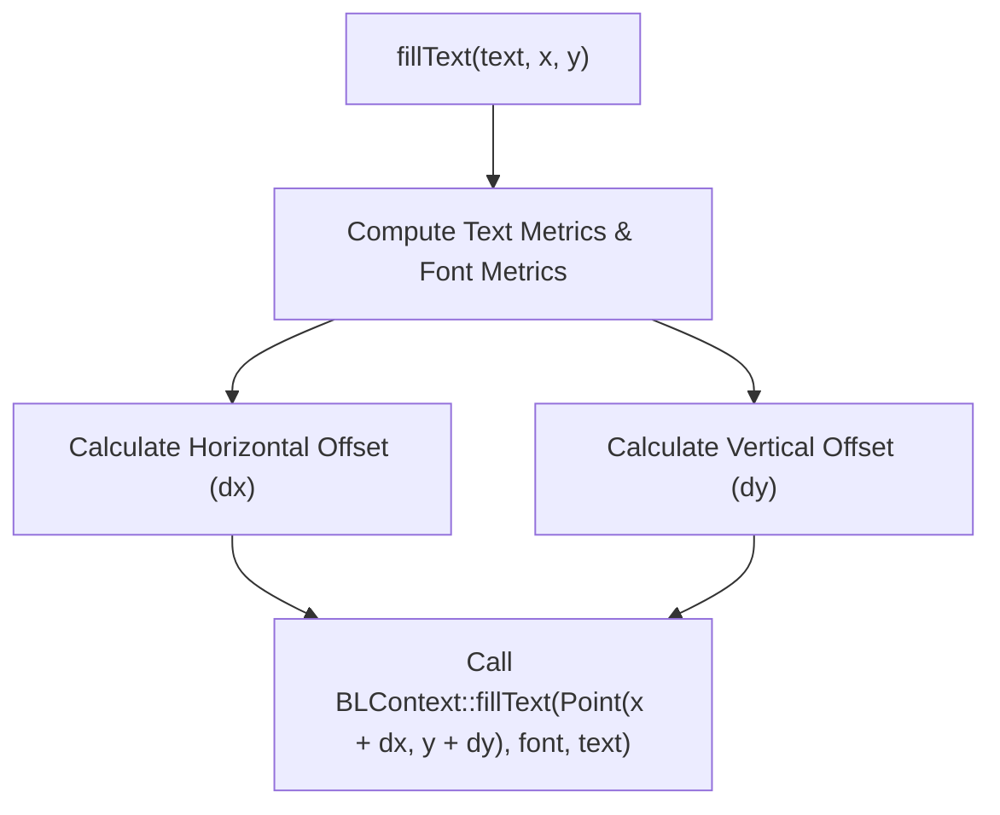

# QPS4: Font and Typography Subsystem Design

**Document ID:** QPS4-Font-and-typography-design  
**Date:** 2026-11-02  
**Target:** `libquickps/canvas` & `paperjs`  
**Toolchain:** Clang 20 (C++26), Meson, QuickJS, Blend2D  

---

## 1. Executive Summary & Problem Statement

In `quickps`, PaperScript scripts often use typography via Paper.js's `PointText` (`new PointText(...)`). Under the hood, Paper.js issues standard HTML5 Canvas 2D calls:
```javascript
ctx.font = 'bold 16px "Inter", sans-serif';
ctx.textAlign = 'center';
ctx.textBaseline = 'middle';
var width = ctx.measureText(line).width;
ctx.fillText(line, x, y);
```

### Current Status in `quickps`:
1. **Completely Inoperative:**
   In [libquickps/canvas/context.hpp](file:///home/ksh/c_projects/quickps/libquickps/canvas/context.hpp):
   ```cpp
   void FillText(double text, double x, double y, double maxWidth);
   void StrokeText(double text, double x, double y, double maxWidth);
   void MeasureText(double text);
   int font;
   int textAlign;
   int textBaseline;
   ```
   - Parameters are incorrectly typed as `double text` instead of `std::string` / `std::string_view`.
   - Bodies in [libquickps/canvas/context.cpp](file:///home/ksh/c_projects/quickps/libquickps/canvas/context.cpp) are empty no-ops (`{}`).
   - None of `fillText`, `strokeText`, `measureText`, `font`, `textAlign`, or `textBaseline` are registered in the QuickJS prototype.
   - Any Paper.js script using `PointText` immediately crashes (`TypeError: ctx.measureText is not a function`) or silently fails to render text.

2. **The Blend2D Typography Model vs. Canvas 2D:**
   - **Canvas 2D:** Accepts high-level CSS font strings (e.g., `"italic bold 18px 'Roboto', sans-serif"`), resolves fonts via the browser engine, and aligns glyphs automatically based on `textAlign` and `textBaseline`.
   - **Blend2D:** Is a pure 2D rendering library. It includes an OpenType/TrueType glyph parser, rasterizer, and shaper (`BLFontFace`, `BLFont`, `BLGlyphBuffer`), but **it bundles zero font data files** and has **no CSS font cascading/matching engine**. It requires explicit font bytes or font files to construct a `BLFontFace`.

---

## 2. Core Architectural Challenges & Requirements

| Challenge | Requirement | Proposed Solution |
| :--- | :--- | :--- |
| **Zero External Font Runtime Dependency** | `quickps` is a static CLI tool. It must work inside minimal Docker/Alpine containers without OS fonts installed. | Embed a lightweight, open-source fallback TrueType font directly into `.rodata` via Clang 20 `#embed`. |
| **Custom Font Support** | Users must be able to specify custom project fonts. | CLI option `--font-path <dir\|file>` + cache `BLFontFace` by family name/path. |
| **CSS Font Shorthand Parsing** | Canvas 2D passes strings like `"bold 14px 'Inter', sans-serif"`. | Lightweight parser extracting `style`, `weight`, `size`, and `family`. |
| **Alignment & Baseline Metrics** | Canvas `textAlign` and `textBaseline` offset glyph origins relative to $(x, y)$. | Compute layout offset using Blend2D's `BLFontMetrics` and `BLTextMetrics`. |
| **`measureText()` API** | Must return a `TextMetrics` object with `width`. | Return a QuickJS JSObject containing `{ width: advance.x }`. |
| **State Preservation** | `save()` and `restore()` must preserve font settings. | Store font styling in `ContextState` on the stack. |

---

## 3. Font Data Provisioning Strategy

### 3.1 Embedded Default Fallback Font (Zero Dependency)
To ensure `quickps` never fails when no OS fonts exist:
1. Select a compact, high-legibility open-source TrueType font (e.g., **Inter Regular** or **Roboto Regular**, ~150–200 KB).
2. Embed the font binary into `.rodata` using Clang 20's native `#embed`:
   ```cpp
   namespace {
   constexpr uint8_t kDefaultFontData[] = {
   #embed "fonts/Inter-Regular.ttf"
   };
   }
   ```
3. Initialize a singleton `BLFontFace` and `BLFontData`:
   ```cpp
   BLFontData default_font_data;
   default_font_data.createFromData(kDefaultFontData, sizeof(kDefaultFontData));
   BLFontFace default_font_face;
   default_font_face.createFromData(default_font_data, 0 /* face index */);
   ```

### 3.2 Font Resolution & Cache (FontManager)
A lightweight font manager keeps a registry of loaded faces:
```cpp
class FontManager {
public:
  static FontManager &Instance();
  
  void RegisterFontFile(const std::filesystem::path &path);
  void RegisterFontDirectory(const std::filesystem::path &dir);
  
  BLFont ResolveFont(std::string_view family, double size, int weight, bool italic);

private:
  BLFontFace default_face_;
  std::unordered_map<std::string, BLFontFace> faces_by_family_;
};
```

1. **Resolution Hierarchy:**
   - Exact family match in `faces_by_family_` (case-insensitive).
   - System standard font paths (if existing: `/usr/share/fonts`, `/System/Library/Fonts`, etc.).
   - Fallback to embedded `default_face_`.
2. **Instantiating `BLFont`:**
   ```cpp
   BLFont font;
   font.createFromFace(resolved_face, static_cast<float>(size));
   ```

---

## 4. CSS Font String Parsing

The CSS font property is a shorthand:
`[font-style] [font-variant] [font-weight] font-size[/line-height] font-family`

Examples:
- `"16px sans-serif"`
- `"bold 14px Arial"`
- `"italic 300 24px 'Open Sans', sans-serif"`

### Scanner Specification:
```cpp
struct ParsedFont {
  double size = 10.0; // default 10px in Canvas spec
  int weight = 400;   // 400 = normal, 700 = bold
  bool italic = false;
  std::string family = "sans-serif";
};
```
- Tokens matching `italic` / `oblique` $\rightarrow$ `italic = true`.
- Tokens matching `bold` $\rightarrow$ `weight = 700`; numeric weights `100`..`900` parsed via `std::from_chars`.
- Token ending in `px`, `pt` (converted to px: $1\text{pt} = 4/3\text{px}$), `%`, `em` $\rightarrow$ parsed into `size`.
- Remaining tokens $\rightarrow$ trimmed family name (stripping surrounding quotes `'` or `"`).

---

## 5. Text Alignment & Baseline Math

HTML5 Canvas coordinates $(x, y)$ represent the anchor point. Blend2D draws text relative to the baseline start. We compute $(\Delta x, \Delta y)$ offsets before invoking `BLContext::fill_text`:



### 5.1 Horizontal Alignment (`textAlign`):
Using `BLTextMetrics tm` (`tm.advance.x`):
- `"left"` / `"start"` (LTR): $\Delta x = 0$
- `"right"` / `"end"` (LTR): $\Delta x = -\text{tm.advance.x}$
- `"center"`: $\Delta x = -\frac{\text{tm.advance.x}}{2}$

### 5.2 Vertical Alignment (`textBaseline`):
Using `BLFontMetrics fm` (`fm.ascent`, `fm.descent`, `fm.capHeight`, `fm.xHeight`):
- `"alphabetic"` (Default): $\Delta y = 0$ (anchor is at baseline)
- `"top"`: $\Delta y = +\text{fm.ascent}$
- `"hanging"`: $\Delta y = +\text{fm.ascent} \times 0.8$
- `"middle"`: $\Delta y = +\frac{\text{fm.ascent} - \text{fm.descent}}{2}$
- `"bottom"`: $\Delta y = -\text{fm.descent}$
- `"ideographic"`: $\Delta y = -\text{fm.descent}$

---

## 6. Canvas 2D Text API QuickJS Binding

### 6.1 Context Methods & Properties to Expose:
```cpp
// In ClassBuilder<canvas::Context>:
.Proto(EntryBuilder<canvas::Context>()
           .Name("font")
           .Getter<get_font>()
           .Setter<set_font>()
           .Build())
.Proto(EntryBuilder<canvas::Context>()
           .Name("textAlign")
           .Getter<get_text_align>()
           .Setter<set_text_align>()
           .Build())
.Proto(EntryBuilder<canvas::Context>()
           .Name("textBaseline")
           .Getter<get_text_baseline>()
           .Setter<set_text_baseline>()
           .Build())
.Proto(EntryBuilder<canvas::Context>()
           .Name("fillText")
           .Method<FillText>(2) // text, x, y, [maxWidth]
           .Build())
.Proto(EntryBuilder<canvas::Context>()
           .Name("strokeText")
           .Method<StrokeText>(2)
           .Build())
.Proto(EntryBuilder<canvas::Context>()
           .Name("measureText")
           .Method<MeasureText>(1)
           .Build())
```

### 6.2 `measureText(text)` Implementation:
```cpp
quickjs::Value MeasureText(quickjs::Context &ctx, quickjs::Value &this_val,
                           quickjs::ValueIter first, quickjs::ValueIter last) {
  auto *self = ctx.GetOpaque<canvas::Context>(this_val);
  auto text = first++->Get<std::string>(ctx);

  BLGlyphBuffer gb;
  gb.setUtf8Text(text.data(), text.size());
  
  BLTextMetrics tm;
  self->GetFont().getTextMetrics(gb, tm);

  auto obj = ctx.NewObject();
  obj.Set("width", ctx.NewDouble(tm.advance.x));
  return obj;
}
```

---

## 7. Implementation Roadmap

1. **Phase 1: Embedded Font & Basic Text Rendering**
   - Add a clean open-source font TTF (e.g. `Inter-Regular.ttf`) in `resources/fonts/`.
   - Embed via `#embed` in `libquickps/canvas/font.cpp`.
   - Update `context.hpp` and `context.cpp` signatures (`const std::string &text`).
   - Implement basic `font` string parser and baseline calculation.
   - Bind `font`, `textAlign`, `textBaseline`, `fillText`, and `measureText` in QuickJS.
2. **Phase 2: Custom Fonts & State Stack**
   - Push `font`, `textAlign`, `textBaseline` onto `ContextState` during `save()` and `restore()`.
   - Add `--font-path` CLI parameter in `qpsc` to allow loading custom user fonts.
   - Implement `strokeText` using `BLContext::strokeText`.
